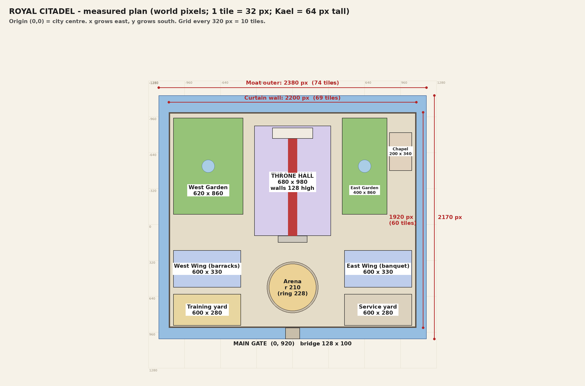

# Royal Citadel: dimensions

All sizes are in **world pixels** (the game's unit).

- **1 tile = 32 px.** Kael is **64 px** tall (2 tiles).
- **Origin (0, 0)** is the centre of the city and of the citadel. x grows to the east, y grows to the south.
- **Rect format:** `Rect2(x, y, width, height)`, where (x, y) is the top-left corner. This is the
  same format as in the code (`scripts/geo.gd`, `citadel.gd`, `citadel_floors.gd`).

## Scale references
| Quantity | Value |
|----------|-------|
| One tile | 32 px |
| Kael's height | 64 px. If he is about 1.75 m tall, then **1 m ≈ 36.6 px** |
| Kael's walking speed | 210 px/s ≈ 6.6 tiles/s |
| Screen on a 1080p phone | 1196 × 540 px ≈ 37 × 17 tiles visible |
| Screen on a 16:9 monitor | 960 × 540 px = 30 × 17 tiles |

## The whole castle
| Part | Rect / position | Size (px) | Tiles | Approx. metres | Walk across |
|------|-----------------|-----------|-------|----------------|-------------|
| Moat (outer edge) | `Rect2(-1190, -1150, 2380, 2170)` | 2380 × 2170 | 74.4 × 67.8 | 65 × 59 m | 11.3 s |
| Curtain wall (outer) | `Rect2(-1100, -1000, 2200, 1920)` | 2200 × 1920 | 68.8 × 60 | 60 × 52 m | 10.5 s |
| Ground inside the walls | | ≈ 2144 × 1864 | | **≈ 4.0 million px²** | |
| Moat width | west/east 90, north 150, south 100 | | | 2.5–4 m | |
| Curtain wall | height 72, walkway thickness 28 | | | | |
| Main gate | centre `(0, 920)`, opening 132 wide | | | | |
| Bridge | `Rect2(-64, 920, 128, 100)` | 128 × 100 | 4 × 3.1 | | |

## Main floor buildings and areas
| Part | Rect | Size (px) | Tiles | Area (px²) | Share of the castle |
|------|------|-----------|-------|------------|---------------------|
| Grand Throne Hall | `Rect2(-340, -880, 680, 980)` | 680 × 980 | 21.3 × 30.6 | 666,400 | 16% |
| · its walls are 128 high | dais `Rect2(-180, -862, 360, 96)`, carpet 80 × 864 | | | | |
| Chapel | `Rect2(860, -820, 200, 340)` | 200 × 340 | 6.3 × 10.6 | 68,000 | 2% |
| West Wing (barracks) | `Rect2(-1060, 230, 600, 330)` | 600 × 330 | 18.8 × 10.3 | 198,000 | 5% |
| East Wing (banquet) | `Rect2(460, 230, 600, 330)` | 600 × 330 | 18.8 × 10.3 | 198,000 | 5% |
| West Garden | `Rect2(-1060, -950, 620, 860)` | 620 × 860 | 19.4 × 26.9 | 533,200 | 13% |
| East Garden | `Rect2(440, -950, 400, 860)` | 400 × 860 | 12.5 × 26.9 | 344,000 | 8% |
| Training yard | `Rect2(-1060, 620, 600, 280)` | 600 × 280 | 18.8 × 8.8 | 168,000 | 4% |
| Service yard | `Rect2(460, 620, 600, 280)` | 600 × 280 | 18.8 × 8.8 | 168,000 | 4% |
| Arena | centre `(0, 560)`, radius 210, stone ring to 228 | Ø 420 (456) | Ø 13 | 138,500 | 3% |
| Grand steps | `Rect2(-130, 100, 260, 60)` | 260 × 60 | | | |
| Open courtyard (the rest) | | | | ≈ 1.6 million | ≈ 40% |

Building wall heights (how tall the walls are drawn): throne hall 128, wings 112, chapel 96.

## Royal Residence (stairs up)
The floor's origin is at world `(20000, 0)`. The rects below are local to that origin.
Each room also has a back wall above it (96 px tall) plus a 12 px stone cap.

| Room | Rect (local) | Size (px) | Tiles |
|------|--------------|-----------|-------|
| Royal corridor | `Rect2(-640, 0, 1280, 160)` | 1280 × 160 | 40 × 5 |
| King and Queen | `Rect2(-640, -420, 310, 300)` | 310 × 300 | 9.7 × 9.4 |
| Princes | `Rect2(-306, -420, 270, 300)` | 270 × 300 | 8.4 × 9.4 |
| Princess | `Rect2(-12, -420, 220, 300)` | 220 × 300 | 6.9 × 9.4 |
| King's sister's family | `Rect2(232, -420, 408, 300)` | 408 × 300 | 12.8 × 9.4 |
| Royal Library | `Rect2(-240, 264, 480, 220)` | 480 × 220 | 15 × 6.9 |
| Whole floor (with walls) | x −652 … 652, y −528 … 496 | 1304 × 1024 | 40.8 × 32 |

Doorways are 56 px wide.

## Service Floor (stairs down)
The floor's origin is at world `(20000, 4000)`.

| Room | Rect (local) | Size (px) | Tiles |
|------|--------------|-----------|-------|
| Service hall | `Rect2(-480, 0, 960, 160)` | 960 × 160 | 30 × 5 |
| Kitchen | `Rect2(-480, -420, 360, 300)` | 360 × 300 | 11.3 × 9.4 |
| Storeroom | `Rect2(-96, -420, 240, 300)` | 240 × 300 | 7.5 × 9.4 |
| Servants' quarters | `Rect2(168, -420, 312, 300)` | 312 × 300 | 9.8 × 9.4 |
| Whole floor (with walls) | x −492 … 492, y −528 … 172 | 984 × 700 | 30.8 × 21.9 |

## Notes for redesigning
- **It's compact for a royal citadel.** At 1 m ≈ 36.6 px, the walls enclose about 60 × 52 m,
  which is the size of a small castle bailey. Real royal citadels are often 150–300 m across.
  Games usually shrink distances, but if you want it to feel grander, scaling the whole plan
  by 1.5× (3300 × 2880 px inside the walls) is about 16 s of walking across.
- **The city around it** limits growth. The ring road is at radius 1720 and the city wall at 2600.
  The moat's corners reach radius ≈ 1650, so the citadel can grow about 1.4× before it touches the ring road.
- **Design on the 32 px grid.** Rooms are easiest when their sizes are multiples of 32,
  for example 320 × 288 for a bedroom (10 × 9 tiles).
- **One screen is about 37 × 17 tiles.** A room smaller than that is shown whole as a fixed
  frame (stage 9 camera). A room larger than that scrolls.
