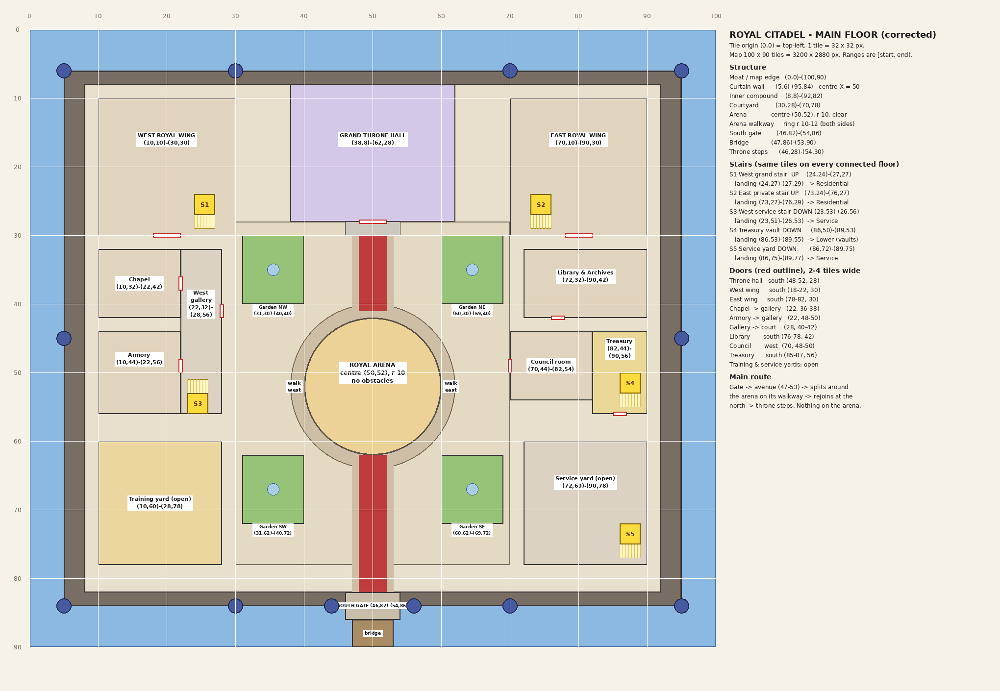

# Royal Citadel: dimensions (v2, stage 10)

The citadel is built on a **100 × 90 tile plan** (3200 × 2880 px).

- **1 tile = 32 × 32 px**, and Kael is 64 px tall (2 tiles).
- **Plan origin (0, 0)** is the top-left corner of the moat.
- **Placement in the world:** plan tile **(50, 45)** is the centre of the city, at world (0, 0).
  - World position of a tile = `(-1600 + 32·x, -1440 + 32·y)`.
  - In code: `Geo.tile(x, y)` and `Geo.trect(x0, y0, x1, y1)`.
- **Ranges** are written `(x0, y0)-(x1, y1)` and include the start tile but not the end tile.

## Structure
| Part | Tiles | World px | Size |
|------|-------|----------|------|
| Moat (map edge) | (0,0)-(100,90) | -1600,-1440 … 1600,1440 | 3200 × 2880 |
| Curtain wall line | (5,6)-(95,84), centred on X = 50 | -1440,-1248 … 1440,1248 | 2880 × 2496 |
| Inner compound | (8,8)-(92,82) | | 2688 × 2368 |
| South gate | (46,82)-(54,86) | | passage 192 px wide |
| Bridge | (47,86)-(53,90) | | 192 × 128 |
| Courtyard | (30,28)-(70,78) | | 1280 × 1600 |
| Arena | centre (50,52), radius 10, clear | | Ø 640 |
| Arena walkway | ring, radius 10–12 | | 64 px wide |
| Throne steps | (46,28)-(54,30) | | |

Towers stand at (5,6), (95,6), (5,84), (95,84), (5,45), (95,45), (30,6), (70,6), (30,84), (70,84), (44,84) and (56,84).

## Rooms (main floor)
| Room | Tiles | Size (px) | Doors |
|------|-------|-----------|-------|
| Grand Throne Hall | (38,8)-(62,28) | 768 × 640 (back wall 128 tall) | south (48–52, 28) |
| West Royal Wing | (10,10)-(30,30) | 640 × 640 | south (18–22, 30) |
| East Royal Wing | (70,10)-(90,30) | 640 × 640 | south (78–82, 30) |
| Chapel | (10,32)-(22,42) | 384 × 320 | east into the gallery (22, 36–38) |
| Armory | (10,44)-(22,56) | 384 × 384 | east into the gallery (22, 48–50) |
| West gallery | (22,32)-(28,56) | 192 × 768 | east onto the courtyard (28, 40–42) |
| Training yard (open) | (10,60)-(28,78) | 576 × 576 | open |
| Library and Archives | (72,32)-(90,42) | 576 × 320 | south (76–78, 42) |
| Council room | (70,44)-(82,54) | 384 × 320 | west (70, 48–50) |
| Treasury | (82,44)-(90,56) | 256 × 384 | south (85–87, 56) |
| Service yard (open) | (72,60)-(90,78) | 576 × 576 | open |
| Gardens | (31,30)-(40,40), (60,30)-(69,40), (31,62)-(40,72), (60,62)-(69,72) | 288 × 320 each | |

## Staircases
Each staircase uses the same tiles on every floor it connects, so the floors line up.

| Stair | Footprint | Landing (kept clear) | Leads to |
|-------|-----------|----------------------|----------|
| S1 West grand stair (up) | (24,24)-(27,27) | (24,27)-(27,29) | Residential floor |
| S2 East private stair (up) | (73,24)-(76,27) | (73,27)-(76,29) | Residential floor |
| S3 West service stair (down) | (23,53)-(26,56) | (23,51)-(26,53) | Service floor |
| S4 Treasury vault stair (down) | (86,50)-(89,53) | (86,53)-(89,55) | Lower floor (vaults) |
| S5 Service-yard stair (down) | (86,72)-(89,75) | (86,75)-(89,77) | Service floor |

## The city around it
The city was grown **1.45×** to make room (`Geo.K` in `scripts/geo.gd`):

| Ring | Before | Now |
|------|--------|-----|
| Ring road | 1720 | 2494 |
| City wall | 2600 | 3770 |
| Cliff edge | 3250 | 4712 |
| World half-size | 5600 | 8120 |

Every landmark (gates, Haldor's yard, the market, inn, outpost, mine, quarry, den, roads)
moved outward with the city. Building and yard sizes didn't change.
