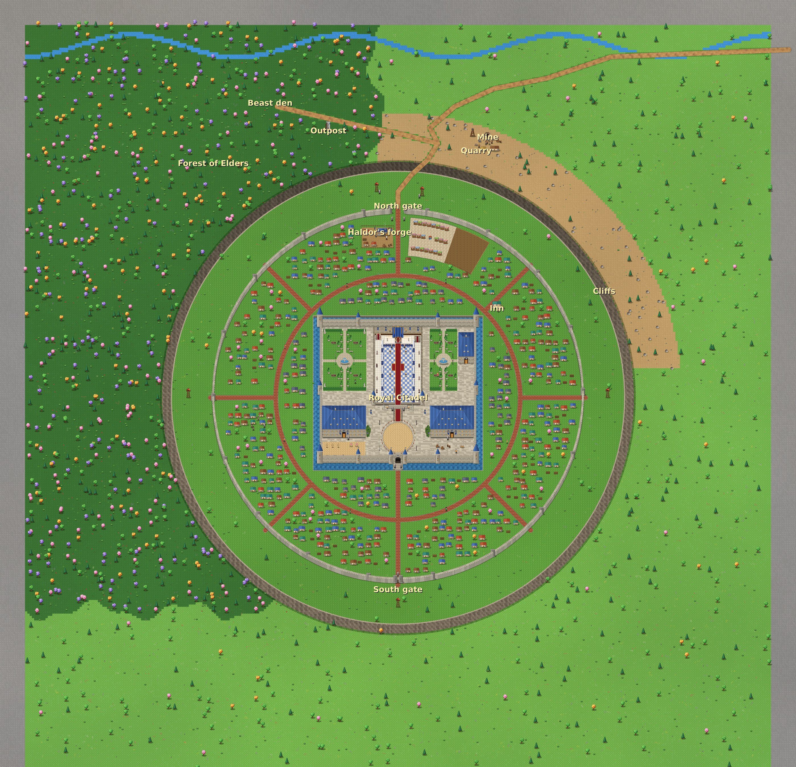
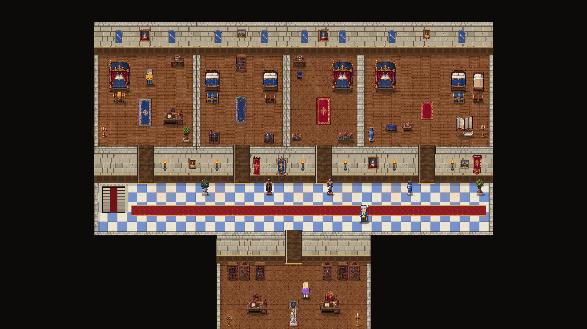
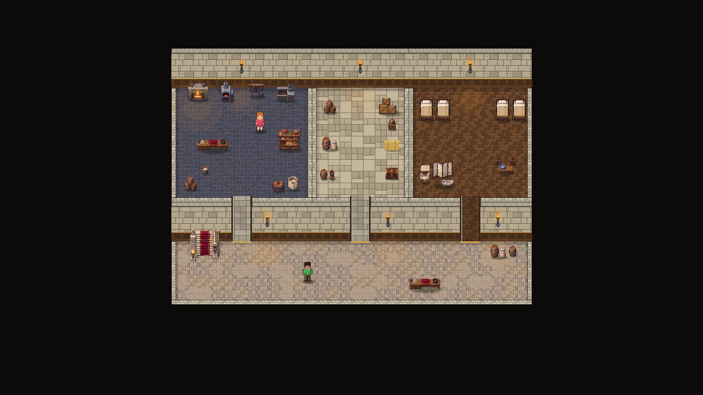

# World map

The whole open world (11,200 × 11,200 px, rendered from the game itself).

- **Akropolis Aigidos** sits in the middle: a ring of city walls with the North and South
  gates, a ring road, spoke streets and houses.
- **The Royal Citadel** is at the centre, inside its moat.
- **Haldor's forge yard** is just inside the North gate.
- **North of the walls:** the plateau, the cliffs with a ramp down to the mine and the quarry,
  the outpost, and the beast den in the Forest of Elders. The stream runs along the far north.
- **The rest:** open meadows to the east and south, ringed by mountains at the world's edge.

## Citadel floors

**Royal Residence (stairs up):** the corridor; the chambers of the King and Queen, the
princes, the princess and the king's sister's family; and the Royal Library below the corridor.

**Service Floor (stairs down):** the service hall, kitchen, storeroom and servants' quarters.

