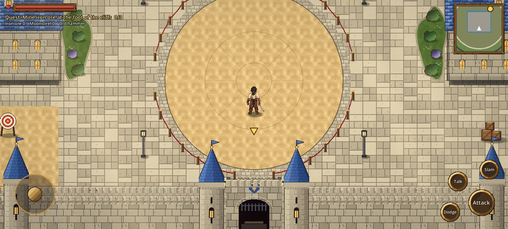

# Stage 6: Royal Citadel, main floor

**Commit:** `c6f7849` · **Date:** 2026-10-22

## Goal
Start redesigning the world from the capital's castle, following the Royal Citadel blueprint.
The Citadel replaces the old city centre, and its walls must be completely static.

## What changed
- **The castle grounds:** a curtain wall with towers, a moat with moving water, and the gatehouse with its bridge.
- **The Royal Courtyard:** a battle arena, grand steps and a red carpet up to the throne hall.
- **The Grand Throne Hall** (walk-in): its roof fades away when Kael enters. Inside are
  pillars, braziers and the throne on its dais.
- **The other buildings:** the West and East Gardens with fountains and hedges, the Chapel
  (walk-in), the West and East Wings, the military training yard and the service yard.
- **People:** guards, courtiers, a gardener and Sister Maren, all with dialogue.
- **Guide arrow:** routes around the moat and through the gate.

## Where it lives
| File | Role |
|------|------|
| `scripts/citadel.gd` | Builds the whole citadel from modular pieces |
| `scripts/cit_wall.gd`, `cit_building.gd`, `cit_interior.gd` | Walls, buildings with fading roofs, interiors |
| `scripts/cit_ground.gd`, `cit_moat.gd`, `cit_hedge.gd`, `cit_sprite.gd` | Ground, water, hedges, props |
| `tools/make_citadel.py` | Citadel textures and sprites (`art/cit_*.png`) |

