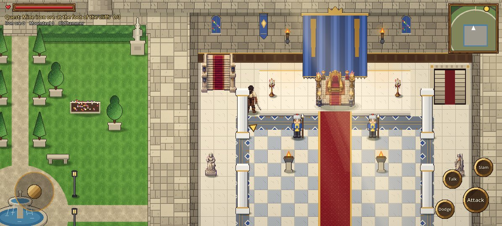
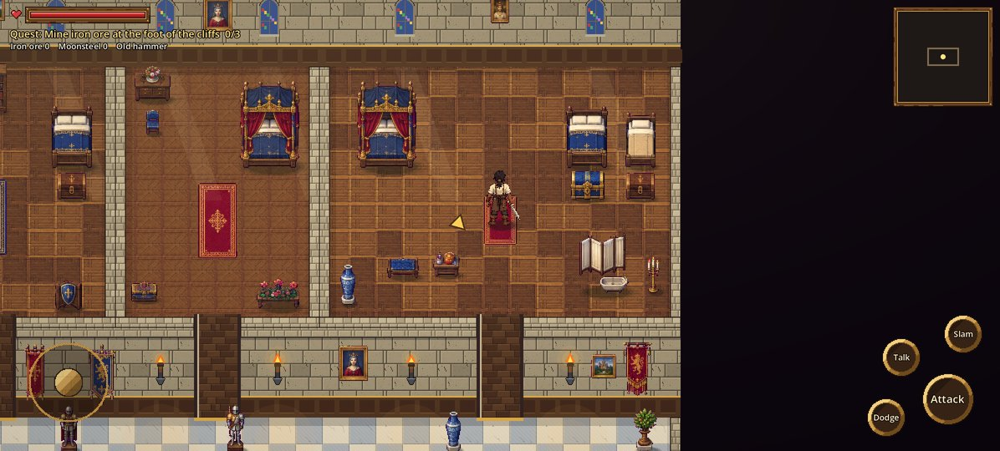
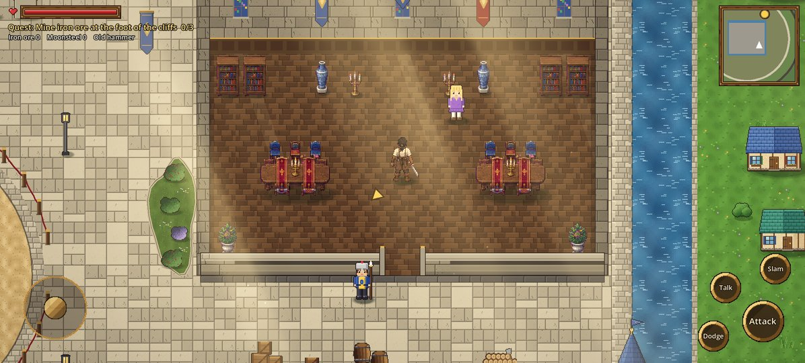
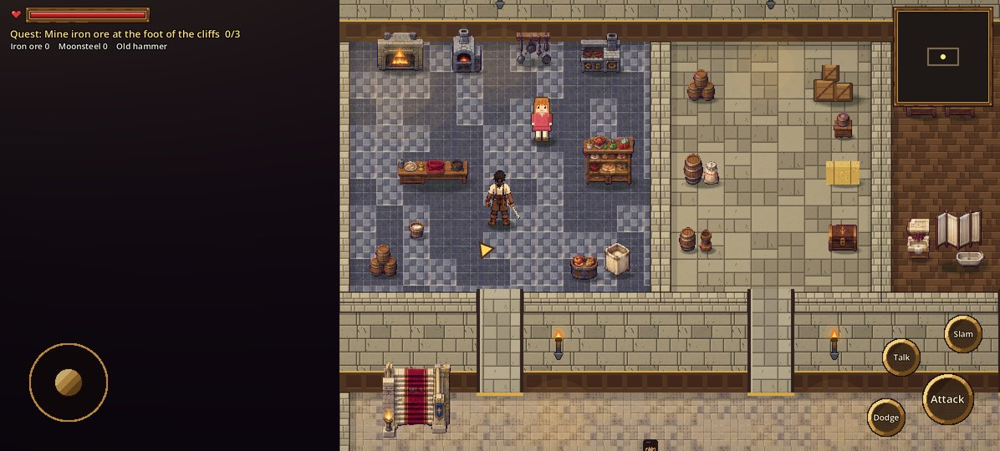

# Stage 7: Citadel visual upgrade

**Commit:** `9f75ca1` · **Date:** 2026-10-22

## Goal
Raise the visual quality of one connected part of the castle (the courtyard, throne hall,
royal corridor and stairs) to a standard the rest of the castle can follow. Let Kael enter
every place so it can all be checked.

## What changed
- **The castle art sheet** (AI-generated, on magenta) was imported into 139 separate sprites.
  They're grouped as tiles, rugs, furniture, decor, walls and kitchen, all at one pixel scale
  with a bottom-centre pivot (`tools/import_castle.py`, `art/castle/manifest.json`).
- **Courtyard:**
  - Flagstones in four layouts, chosen per tile, so the ground never repeats.
  - A cobbled avenue with dark kerbs, and a rope fence around the arena.
  - Irregular planting beds.
- **Throne hall:**
  - A checkered marble nave with inlaid borders, rugs, and the throne under a canopy.
  - Statues and armour in the side aisles, wall torches, and light falling from the windows.
  - Inside, a low cut-down front wall replaces the tall one, so Kael can be seen behind it.
- **Working stairs:** walking onto them fades the screen for about half a second. There is no
  loading screen, because each floor is already built far away in the same world.
  - **Royal Residence (up):** the King and Queen's chamber, the princes' room, the princess's
    room, the king's sister's rooms and the Royal Library.
  - **Service Floor (down):** the kitchen, storeroom and servants' quarters.
- **West Wing** (barracks and armory) and **East Wing** (banquet hall) are now furnished and open.

## Scene layers
1. **Ground** (`cit_ground.gd`, `cit_interior.gd`, `floor_plan.gd`): floors, rugs and wall faces, under everything.
2. **Y-sorted entities:** buildings, furniture, people and Kael, sorted by where their feet are.
3. **Effects overlay**, then the colour grade, then the HUD.

Collision boxes are separate from the art, so decoration never blocks doors or paths.

## How it was checked
- Every door and both staircases were walked through by a test bot.
- The full mission test still passes.
- Screenshots were taken at the phone's resolution.

