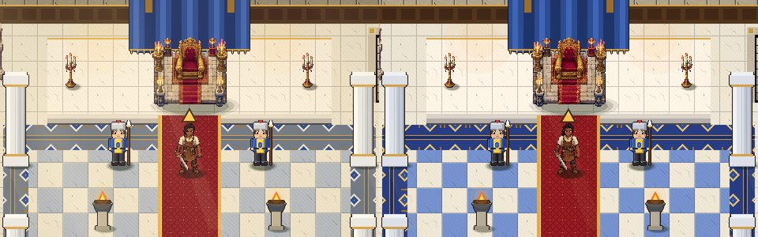
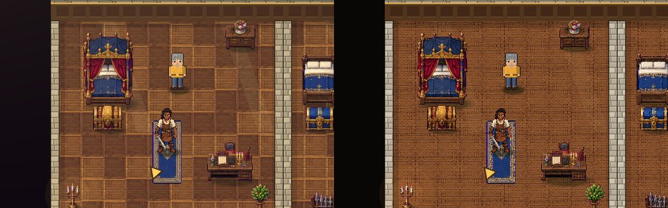
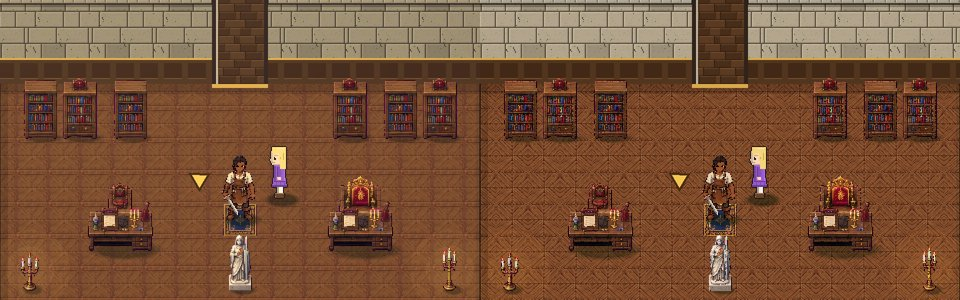
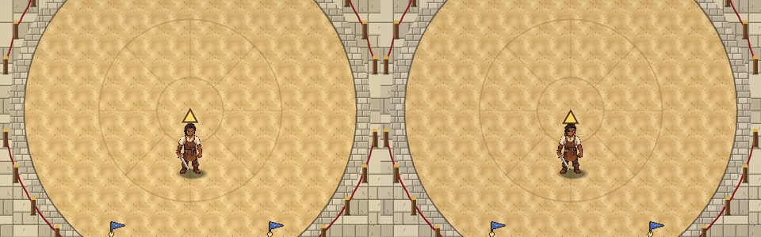

# Stage 8: Colour correction

**Commit:** `f8f4452` · **Date:** 2026-10-22

## Goal
In the game, the imported castle art didn't match the colours of the approved reference sheet.
Find out why by measuring, not guessing. Fix the cause without redesigning any objects or
touching gameplay.

## Diagnosis: what was measured

**1. Renderer and texture import: no problems.**
- All 6,225 colours of the canopy bed sprite appear unchanged in a screenshot of the running
  game. So there is no tint, no modulation, no compression damage and no filtering.
- 98–99% of 2×2 screen blocks are identical, which means pixels are scaled up as crisp
  squares. The rest are true edges.
- 2D textures import losslessly (`compress/mode=0`) with nearest filtering (project default).
- There is no `CanvasModulate` and no `Light2D` darkening the scene.

**2. Importer: lost contrast and blended colours.**
Averaging 2×2 blocks of the AI sheet invented in-between colours and flattened highlights.

| Sprite | Source contrast | Old import | New import |
|--------|-----------------|------------|------------|
| Lion banner | 0.202 | 0.167 (−17%) | 0.195 (−3%) |
| Canopy bed | 0.178 | 0.161 | 0.171 |
| Throne | 0.235 | 0.213 | 0.228 |
| Gold chest | 0.213 | 0.188 | 0.203 |

Saturation now matches the source to within 1%. A pink fringe from the magenta was also
visible on banner and candelabra outlines.

**3. Colour grade: shifted every hue.**
The full-screen grade did four harmful things:
- It desaturated everything by 8%.
- It added a purple cast to every dark colour, which made wood and shadows muddy.
- It pushed highlights yellow, which turned ivory into cream-yellow.
- It laid sun shafts and sky glow over indoor rooms, which washed them out.

On average it moved each screen pixel by 4–7 levels away from the artwork.

**4. Indoor lighting and walls.**
- Wall faces were tinted to 72–86% brightness, which made the limestone look grey.
- Window light was grey-white.
- The throne hall's checker was a dull grey-blue instead of royal blue.

## What changed
- **Importer** (`tools/import_castle.py`):
  - Each scaled-down pixel now takes the real source pixel closest to its block's median,
    so no new colours are invented.
  - Magenta spill is removed from outlines before cutting.
  - Floor tiles are cropped inside their drawn frames, so tiled floors show no grid.
  - Tile variants are mirrored copies, and tiles snap back to their own source palette after resizing.
- **Colour grade** (`grade.gdshader`, `grade.gd`):
  - Neutral saturation, no shadow colour cast, and a light vignette.
  - Sun shafts, sky glow and the warm cast fade out whenever Kael is under a roof
    (`main.is_indoors()`).
  - Pixels now move 3.6–3.9 levels on average, and most of that is the vignette.
- **Lighting:**
  - Torch and fireplace light is warm orange and restrained.
  - Window light is warm and faint.
  - Nothing is darkened globally.
- **Walls:** warm ivory limestone at full brightness. Side walls are only slightly darker, for depth.
- **Throne hall floor:** cream and royal-blue marble, with navy and gold inlaid borders.

## How it was checked
- The same four scenes (throne room, courtyard, royal bedroom, library) were captured before
  and after, with the grade on and off. The left half of each image below is before, the right half is after.
- The full Mission 1 test still passes.

## Known issues and next steps
- The townsfolk, guards and courtiers still use the older, simpler character sprites. They need
  new sheets in the same style as Kael and the castle sheet.
- A few placeholder pieces remain: the canopy, wall torches, the stairs going down, and the courtyard plants.
