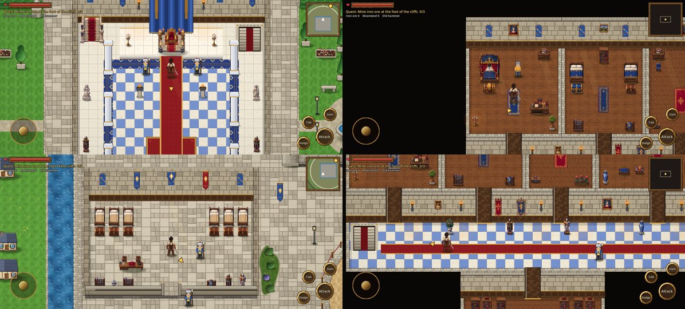

# Stage 9: CrossCode-style camera

**Date:** 2026-10-22

## Goal
Stop the camera from simply sitting on Kael's head like most 2D games. Each place should
have its own framing, following the camera in *CrossCode*.

## What changed
- **Camera zones:** every area (throne hall, chapel, each wing, each upstairs and downstairs
  room, the castle grounds) is a rectangle the camera never looks past.
  - When an area is narrower than the screen, the camera holds it centred. The throne hall
    becomes a symmetrical, framed shot, and small bedrooms sit still like a stage.
  - Bigger areas scroll, but stop at their walls, so the corridors only slide sideways.
- **Look-ahead:** the camera leans about 44 px ahead of the direction Kael is walking.
- **Gliding between areas:** walking into another zone eases the camera over slowly at
  first, then it settles back to normal follow speed.
- **Conversations:** while talking, the camera frames both Kael and the person he is speaking to.
- Still pixel-perfect: the final position is always rounded to a whole pixel.
- The open world outside the castle has no zone, so it uses the free follow with look-ahead.

## Where it lives
| File | Role |
|------|------|
| `scripts/main.gd` | `add_camera_zone()`, `_update_camera()` |
| `scripts/citadel.gd`, `citadel_floors.gd` | Zones for each building and room |

## How it was checked
The screenshot tour shows the framed throne hall, a framed bedroom, the West Wing and the
corridor. The mission test still passes.

## Next
- Hand-placed cinematic pans (for example, gliding up the carpet to the king before he speaks).
- Zones for the city districts and the forge yard.
