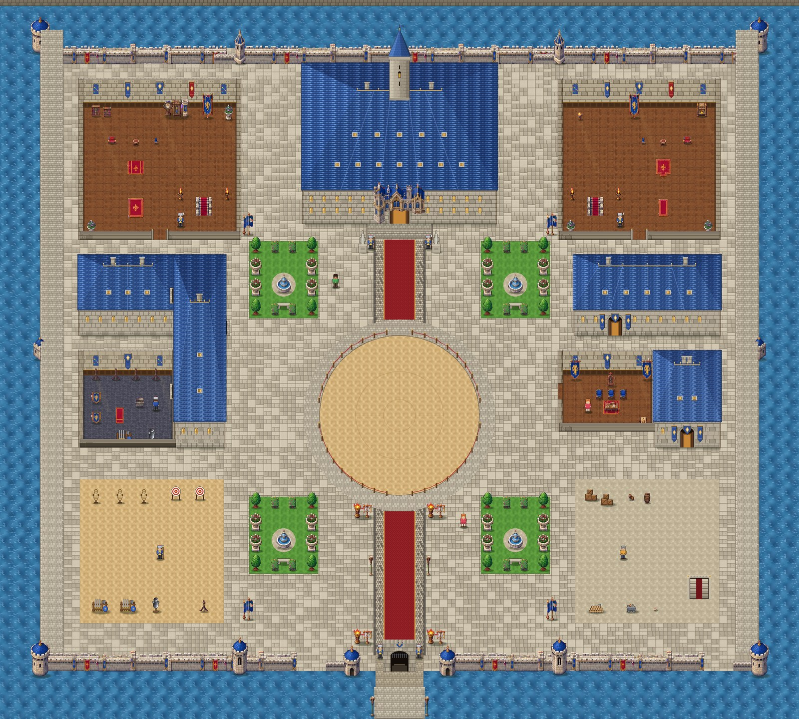

# Stage 10: Royal Citadel v2, main floor

**Date:** 2026-10-22

## Goal
Rebuild the Royal Citadel from the new blueprint and asset atlas at 3200 × 2880 px
(100 × 90 tiles). Show the plan first, get approval, then build the main floor.

## How the plan was agreed
1. The placement blueprint (picture) and the brief (text) disagreed in several places.
   Following the agreed rule, they were **blended**:
   - **From the text:** which room is on which floor, and the room list.
   - **From the picture:** the overall shape of the castle.
2. **Corrections asked for in review:**
   - The curtain wall was centred on X = 50, at (5,6)-(95,84).
   - The arena stays clear, with a walkway on both sides.
   - All five staircases keep fixed positions.
   - S3 was moved two tiles south.
3. The approved plan is in [CITADEL_DIMENSIONS.md](../CITADEL_DIMENSIONS.md).

## What changed
- **The second atlas** (`source_art/castle/sheet2.png`) was imported into **333 sprites** in the
  folders the brief asked for: walls, towers, gates, roofs, terrain, floors, stairs, rugs, banners,
  royal props, vegetation, lighting, furniture, and library, kitchen, treasury, bath, prison and
  secret-passage props.
  - Each object is named by its position on the sheet (`source_art/castle/sheet2_names.json`).
  - Architecture keeps its native size. Furniture is scaled 2/3 so it matches Kael.
- **The city grew 1.45×** around the bigger castle (`Geo.K`), and everything outside moved with it.
- **New main floor** (`scripts/citadel.gd`), built entirely from the tile plan:
  - **Walls and moat:** curtain walls made of atlas wall pieces, 12 towers, the gatehouse,
    bridge and moat.
  - **Throne hall:** the throne under its canopy, a checkered nave, pillars, braziers and banners,
    and the cathedral front from the atlas over its door.
  - **Royal wings:** both royal wings with their stairs up.
  - **West side:** the chapel and armory open into the west gallery through side doors (new in
    `cit_building.gd`). The gallery holds the service stair down.
  - **East side:** the library, council room and treasury, with the vault stair.
  - **Courtyard:** four formal gardens; a cobbled avenue with a red carpet; the arena with its
    rope fence and walkway.
  - **Yards:** the training yard and the service yard.
- **Stairs S1–S5** use the plan's fixed footprints and landings:
  - S1 and S2 lead to the residential floor.
  - S3, S4 and S5 lead to the service floor. S4 will lead to the vaults once the lower floor is built.
  - Coming back, the residence stairs land on S1 and the service stairs land on S3.

## How it was checked
- **Test bot:** walked through all 9 doors, the gate, both sides of the arena walkway, all five
  staircases, and both return stairs. Every check passed.
- **Mission 1** still completes from start to finish in the larger city.
  - The guide arrow now finishes walking down the ramp before turning off it.
  - The top and bottom of the ramp are kept clear of trees.
- **Screenshots:** a full overview of the castle was rendered from the game.

## Next
- Rebuild the residential and service floors on the same 100 × 90 grid, so the stairs line up
  with S1–S5 on those floors too.
- Build the lower floor (vaults, prison and baths), then the rooftop and the underpassages.
