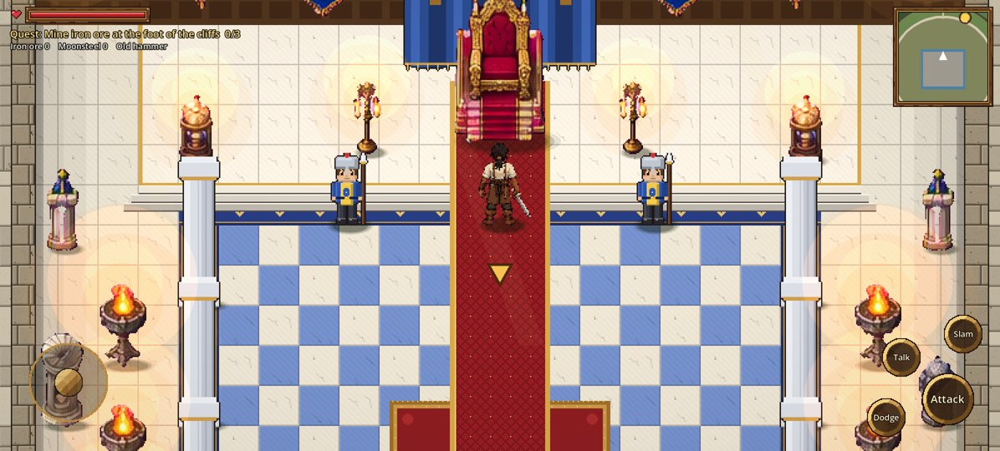
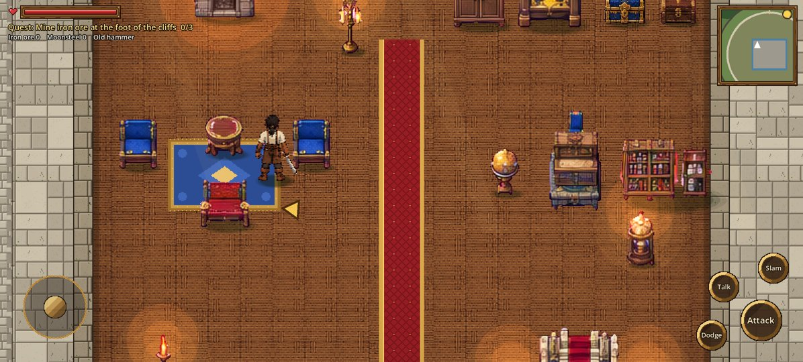

# Stage 11: Main-floor visual polish

**Date:** 2026-10-22

## Goal
Six visual fixes, chosen after reviewing four screenshots of the stage 10 main floor. The layout,
the 100 × 90 grid, room coordinates, collision, Kael, combat and the quest stay unchanged.

## What changed
1. **Throne hall:**
   - **Platform:** the throne platform is bigger, (41,12)-(59,16), with three gold-edged steps and
     the carpet running up it.
   - **Backdrop:** a velvet canopy with large royal banners either side, candelabras, globe lamps
     and wall torches.
   - **Pillars:** four pairs of tall pillars (120 px) frame the checkered nave.
   - **Clear space:** the braziers moved into the side aisles, so the nave stays clear for the final battle.
2. **Furniture scale:** measured every prop. Most furniture is now at native size; four oversized
   pieces and the kitchen props are scaled 2/3 ([FURNITURE_SCALE.md](../FURNITURE_SCALE.md)).
3. **Royal wings:** each wing is arranged in zones, with a runner from the door to the north wall
   and portraits and banners hung on the back wall.
   - **West wing:** a fireplace sitting area, a study, storage along the north wall, an
     attendant's sleeping corner, and the stair.
   - **East wing:** a fireplace sitting area, a family dining table, storage, and a reading corner.
4. **Gardens:** each of the four has its own planting:
   - **NW:** a rose garden.
   - **NE:** an orange orchard around a statue.
   - **SW:** a clipped hedge garden.
   - **SE:** a pine and herb garden.
   All keep their edges open, so Kael can walk through.
5. **Indoor lighting:** a new light layer (`scripts/light_layer.gd`).
   - **Light sources:** every torch, candle, brazier and fireplace casts a warm, stepped pool of
     light on the floor and a faint glow on nearby objects, and the light flickers.
   - **Daylight:** comes only through windows. The armory and treasury have none, so they get none.
   - **Shading:** room edges and corners fall into soft shade.
6. **S4 (the vault stair):** now shows "The vault stairs are sealed…" instead of sending Kael to the service floor.

**Camera:**
- **Interiors:** shown at 1.5× zoom, an exact 3× pixel scale on a 1080p phone. The camera follows
  Kael within the room's walls, so you explore a room rather than seeing it whole.
- **Boss fights:** a new `boss_focus` setting frames Kael and the boss together in the arena.

## How it was checked
- The throne hall and west wing were captured at 2392 × 1080 first, compared with the
  references, and refined: a study replaced empty floor, and the grand staircase was widened.
- Then the other rooms and gardens were captured.
- The door and stair walk test passes (S4 now stays on the main floor), and Mission 1 still completes.

Files changed: `citadel.gd`, `cit_interior.gd`, `main.gd`, `citadel_floors.gd`, `light_layer.gd` (new),
`tools/import_castle.py`, `art/castle2/*`.

