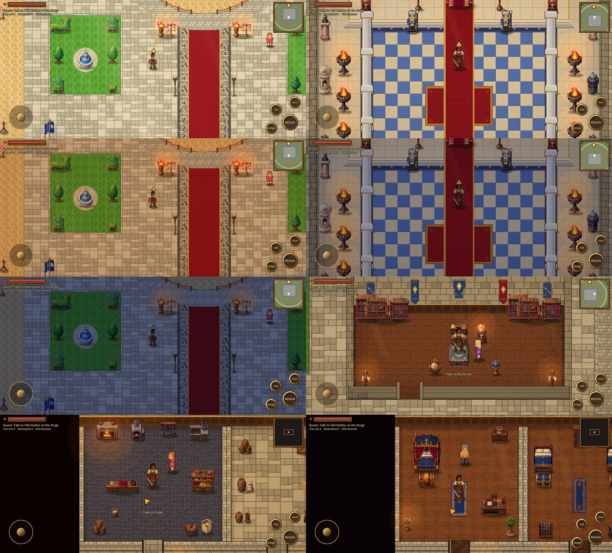

# Stage 12: Living colour grading

**Date:** 2026-10-22

## Goal
Outdoors should feel bright and sunlit. Indoors, light should come only from plausible
sources, and each kind of room should have its own atmosphere. The pixel art must stay
crisp, with its original colours intact.

## Findings before changing anything (renderer, imports, shaders)
- **Renderer and imports:** the GL Compatibility renderer with nearest filtering and lossless
  imports, so sprite colours reach the screen unchanged (measured in stage 8).
- **One full-screen shader** did the sun and the grade. Its sun beams were only switched off
  under a roof, so every interior got the same treatment.
- **No 2D lighting nodes, no darkening overlays:** interiors had no local light sources, so they were evenly lit.

## What changed
- **Six environment profiles** (`scripts/grade.gd`), each with its own ambient colour and
  brightness, highlight and shadow tints, saturation, contrast and vignette:
  - **outdoor:** bright, slightly richer colours, warm highlights.
  - **throne:** warm ivory, controlled.
  - **bedroom:** warm walnut and fabrics, gentle shadows.
  - **library:** amber light, cool corners.
  - **kitchen:** firelight warmth.
  - **stone:** cool, for the armory, treasury, storerooms and later the prison and tunnels.
  - **chapel.**

  Every room registers its profile (`main.add_env_zone`). Walking through a door eases from
  one profile to the next in about half a second.
- **Sun beams and sky glow** appear only outdoors.
- **Light layer** (`scripts/light_layer.gd`): every torch, candle, brazier and fireplace on
  every floor casts a stepped, hard-edged pool of light (pixel art, not a smooth blur) and a
  faint glow on nearby walls and people. The light flickers, and only lights on screen are drawn.
  - **Windows:** rooms with windows get narrow daylight patches on the floor.
  - **Windowless rooms** (armory, treasury) get none.
  - **Corners and edges** fall into soft shade.
- **Time of day is ready:** day, afternoon, sunset and night (`main.time_of_day`).
  - **Outdoors:** sunlight warms toward sunset and turns cool blue at night.
  - **Indoors:** rooms dim at night, so the flames carry them, and flames glow stronger after dark.
  - **For testing:** F2 cycles the time on a computer. A real day/night clock can drive it later.
- **Throne hall marble:** a richer ivory and royal blue, so it no longer looks washed out.
- **Shadows:** cast to the lower right, consistent with sunlight from the upper left.

## How it was checked
- **First test pair:** the courtyard (outdoor) and the throne hall (indoor), captured at
  2392 × 1080 in day, sunset and night, and tuned twice.
  - The throne hall was too pale, so its exposure and the brazier light were reduced and the
    marble was made richer.
- **Then the other rooms:** the library, armory, a royal bedroom, the kitchen and the outdoor town.
- **Gameplay tests:** Mission 1 completes, and all 19 door and stair checks pass.

