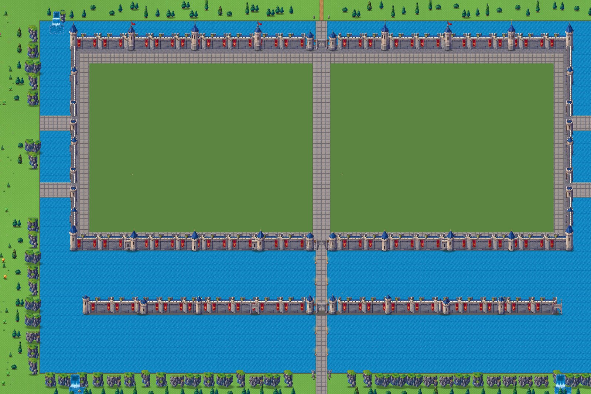

# Stage 13: Royal Castle from scratch, outer layer

**Date:** 2026-10-22

## Goal
Rebuild the castle from scratch using the new reference map (`source_art/castle3/reference_map.png`)
and the new outer-castle kit (`source_art/castle3/sheet3.png`). This stage builds the outer layer
only, at a realistic scale.

## Decisions
- **Placement:** the castle has its own lake beside the city, as in the reference.
  - It sits south of the city. A new road leaves the city's south gate, which is now open, and
    runs down the cliffs to the castle's north bridge.
  - The old citadel in the city centre was removed. Its ground is now a town square with a fountain.
  - The world was grown south (`Geo.WORLD_HALF` 14,000) to fit the lake.
- **Scale:** realistic, about 250 m. With Kael at 64 px (1.75 m), 1 m ≈ 37 px.
  - **Plan:** 336 × 224 tiles (10,752 × 7,168 px), top-left at world (−5376, 5616) (`Geo.CASTLE_O`, `Geo.ct()`).
  - **Main curtain wall:** encloses (26,26)–(310,142), about 9,100 × 3,700 px (≈245 × 100 m).
  - **Kit sprites:** walls, towers, gates, cliffs, waterfalls and trees are scaled 3× with nearest
    filtering. A tower is about 520 px tall (14 m) and a curtain wall about 300 px (8 m). Small
    decor is scaled 2×.

## What was built
- **Lake** (8,12)–(328,212) with moving water and a stone embankment.
- **Island** with a stone quay. The inner ward is left as grass for the next stage, with a paved
  processional way running from the north gate to the main gate.
- **Main curtain wall:** north and south walls from the kit's bannered wall pieces; west and east
  wall walks; 4 great corner towers; 6 towers on each long wall; 3 on each side wall.
  - **Gatehouses:** an arch between two blue towers, at the south (main) and north.
- **Bridges:** four side bridges, small gate towers either side of each side gate, and the north
  bridge to the city road.
- **Barbican (outer wall)** across the lake in front of the main gate: 8 towers and a gatehouse.
  - A torch-lit causeway runs from the main gate through the barbican to the south shore, guarded
    by two angel statues and two guards.
- **Shores:** rocky cliffs and pines on the west, east and south shores; pines along the north shore.
  - **Waterfalls:** the lake spills out at its south-west and south-east corners, and a stream
    falls in at the north-west.
- **Collision:** the lake blocks everything except the island, causeway and bridges. The walls
  are bands 3 tiles deep, with openings only at the gates.

## How it was checked
- **Walk test bot:** walked from the city's south gate down the road, over the north bridge,
  through the ward, out of the main gate, through the barbican and onto the south shore; then
  out over a west bridge. It also confirmed the lake blocks walking. All legs pass.
- **Fixes the test found:** a watchtower and the old sealed gate were blocking the new south road.
  Both were moved.
- **Mission 1** still completes.

## Known differences from the reference, and next steps
- **Shape:** the reference's walls run on diagonals (a hexagonal outline). The kit's wall pieces
  are straight, so the outline here is rectangular with the same parts in the same order.
- **Side walls:** these are wall walks seen from above. They read thinner than the front walls.
- **Next:** the inner ward. The keep and palace at the north, the inner walls, gardens and
  fountain court, the chapel (west), the domed hall and great house (east), the market yard (west),
  and the training ground (east).
