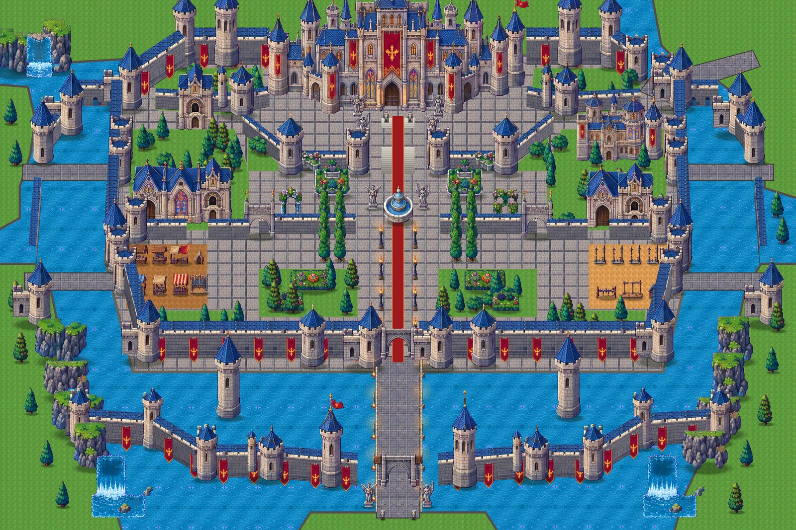

# Stage 14: The whole outer shell of the castle, traced from the reference

**Date:** 2026-10-23

## Goal
Build the complete outer shell of the Royal Castle (every wall, tower, building and garden
seen from outside) so it matches the reference map. The castle should not be square. Use each
kit asset where it belongs, and show only the castle, without the surrounding countryside.

## How it is aligned
- **Traced, not redesigned:** the castle is traced from `source_art/castle3/reference_map.png`.
- **One scale for everything:** the reference map is drawn at the same scale as the kit sheet
  (the palace is about 507 px wide in both). So the map is placed at **3 world px per map px**,
  and the kit sprites are scaled 3× too. Every piece then lands where it stands in the picture.
- **Converting positions:** `Geo.rp(x, y)` turns a map point into a world position. The castle
  spans 4,608 × 3,072 px, about 125 × 83 m with Kael at 1.75 m.
- **Diagonal walls:** walls follow the map's real outline, diagonals included (`MAIN_WALL`,
  `BARBICAN`, `OUTER_LINKS` and `INNER_WALLS` in `castle_outer.gd`). Each wall line is drawn
  with the kit's stone face, slate wall walk, merlons and banners, cut into short pieces so the
  y-sorting stays right.
- **Water:** blocks walking automatically. Every water cell next to walkable ground (shores,
  the castle ground, bridges, the causeway) gets a collision box.

## What is built
- **Lake and shores:** the lake, the shores and cliffs, and waterfalls at both ends of the
  barbican plus one in the north-west hills.
- **Main curtain wall:** follows the reference's eight-sided outline, with its towers, the main
  gatehouse, and the great towers standing in the moat.
- **West and east defences:** towers in the water, the aqueducts, and links. Bridges cross
  on both sides, and a north-east bridge leads to the town shore.
- **Barbican:** the outer wall with its towers, flag towers and gate, and the torch-lit causeway
  with angel statues and guards.
- **Palace (keep):** at the north, with the grand stairs and the red carpet, flanked by angel
  towers. A small upper chapel stands on the west terrace.
- **Inner terrace walls** with their towers. The fountain court has knight statues, flower beds,
  rows of cypress and lamps along the avenue.
- **West:** the church with its two chapels, and the market yard.
- **East:** the domed hall, the manor and the training ground.
- **Planting:** green terraces with pines.

## Castle-only view
`main.gd` has `CASTLE_ONLY := true`. In this view the game builds just the castle on its lake,
with no city or countryside, and Kael starts on the causeway. Set it to `false` for the full game
and Mission 1; the castle is then south of the city, reached by the road from the south gate.

## How it was checked
- **Walk test bot:**
  - **Front:** up the causeway and through both gates, round the fountain, up the stairs to the palace door.
  - **West:** to the church door and through the terrace wall.
  - **Bridges:** out over the west bridge and the north-east bridge.
  - **Water:** a check that the moat blocks walking.
  - All 17 legs pass.
- **Mission 1** still completes in the full game.
- **Rendering:** the whole castle was rendered and compared side by side with the reference.

## Next
- Interiors and floors on the same map coordinates: palace halls, church, domed hall, manor.
