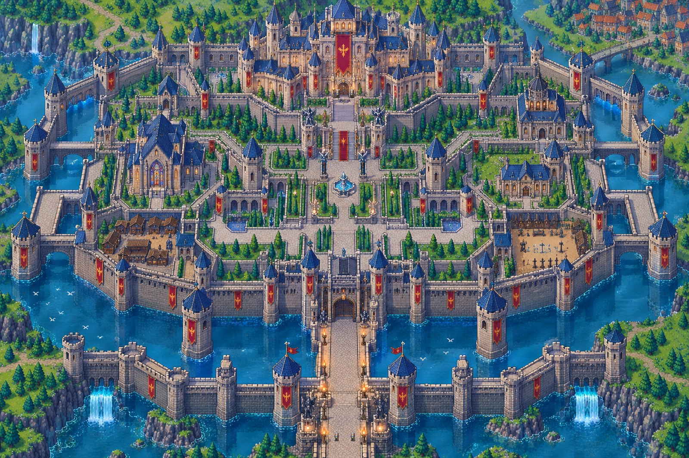

# Stage 15: The castle matches the reference exactly

**Date:** 2026-10-23

## Problem
Stage 14 rebuilt the castle from the kit sheet. The outline was right, but the details
didn't match the reference:
- **Wrong pieces:** some towers used the wrong kit sprites. For example, a round tower stood
  where the reference has a square tower with a banner.
- **Trees:** the number and placement of trees differed.
- **Ground:** the grass and paving textures differed from the painting.

The kit sheet doesn't contain every piece the painting shows, so it can't reproduce it exactly.

## What changed
The castle is now drawn from the reference painting itself
(`art/castle3/castle_painting.png`, a copy of `source_art/castle3/reference_map.png`). It is
shown at 3× with nearest filtering (`Geo.rp()` converts painting px to world px). So every
tower, wall, roof, building, garden, statue and tree is exactly the one in the reference,
with the same count, shape and position.

To make a painting playable, `tools/castle_mask.py` analyses it and writes:
- **`ref_depth.png`:** for every painting pixel, whether it is ground, water or an upright
  thing (wall, tower, roof, tree, statue), and for upright pixels, the y of the base they
  stand on.
- **`ref_collision.json`:** solid boxes. Walkable ground is traced by hand as polygons
  (the causeway, gates, avenue, courtyard and lawns, fountain plaza, grand stairs, palace door,
  the paths past the chapels, the market yard and the training ground; west and east mirror
  each other). Water, statues, the fountain and tree trunks are subtracted from it.

## How it plays
- **Ground layer:** the painting. Water pixels shimmer slowly.
- **Occluder layer:** a second copy of the painting drawn above the characters, through a
  shader. It shows only upright pixels around Kael whose base is south of his feet. So Kael
  walks behind trees, towers, statues and walls, and in front of them when he is south of them.
- **Camera:** stays inside the painting.

## How it was checked
- **Walk test bot:** up the causeway through both gates, round the fountain to the plaza, up
  the grand stairs to the palace door; west across the courtyard past the garden pool, down
  the chapel path into the market yard; the same on the east side into the training ground.
  It also confirmed the moat and the curtain wall block walking.
- **Mission 1** still completes in the full game (`CASTLE_ONLY := false`).
- **Close-ups** checked Kael's draw order with trees and towers.

## Trade-offs
- **Softness:** the painting is an AI image, not hand-placed pixel art. At 3× it is a little
  softer than Kael and the kit sprites.
- **Fixed castle:** the castle is one picture. Changing it means editing the painting, then
  re-running `tools/castle_mask.py`. Moving pieces in code isn't possible.
- **Entry points:** buildings have their doors in the picture but no interiors yet. Those will
  connect at the doors in a later stage.
