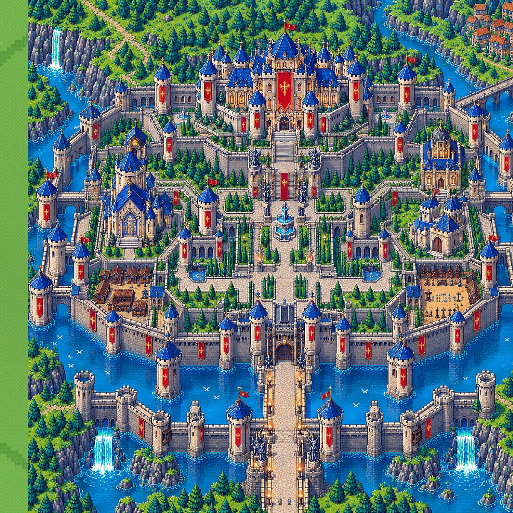

# Stage 16: Crisper castle from the high-quality kit

**Date:** 2026-10-23

## Problem
The castle looked smeared ("texture breaks"). The reference painting was 1536 × 1024 px,
shown 3× larger in the world and then 2× again on the phone, and it is soft AI art rather
than hard-edged pixel art.

## What changed
1. **New castle map** (`source_art/castle4/castle_map.png`, 1728 × 1728).
   - `tools/castle_mask4.py` cleans it into crisp pixel art: it is scaled down to 864 px on
     the art's own pixel grid, sharpened, and reduced to 128 colours with no dithering.
   - The game shows it at 5× (4,320 × 4,320 world px) and every pixel is a hard-edged block.
   - Walkable areas, water, tree and building depth, and collision are generated from it as before.
2. **High-quality castle kit** (`source_art/castle5/sheet5.png`). `tools/castle_sprites5.py`
   places crisp sprites over the map exactly where the map draws the same thing:
   - **Towers:** 36 found by template matching.
   - **Unique buildings:** the palace, cathedral, domed hall, manor, chapel and angel statues,
     each matched inside its own area.
   - **Placed by hand:** the fountain and the two knight statues.
   - Sprites are drawn at 2 world px per pixel, finer than the map's 5. They are y-sorted, so
     Kael walks behind them. The map's own copy under a sprite is masked out of the depth
     layer (`art/castle5/cover.png`).
   - Placements are in `source_art/castle5/placements.json`. Adding, removing or moving a
     sprite means editing that file and re-running the tool, then `castle_mask4.py`.

## How it was checked
- **Walk test bot:** causeway, both gates, fountain, stairs to the palace door, both
  courtyards, the market and the training ground. It also confirmed the moat and walls block.
  All checks pass.
- **Mission 1** still completes in the full game.

## Not done yet
- **Walls, terraces, trees and water** still come from the cleaned map, so they're crisp but
  chunkier (5 px blocks) than the kit sprites.
