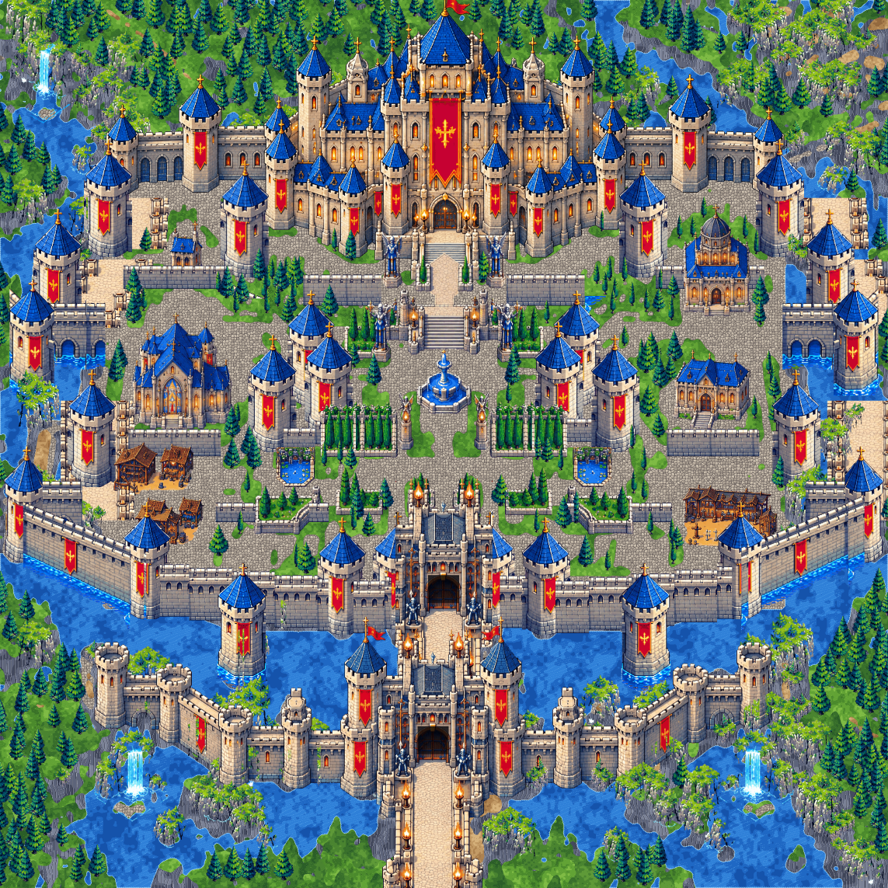
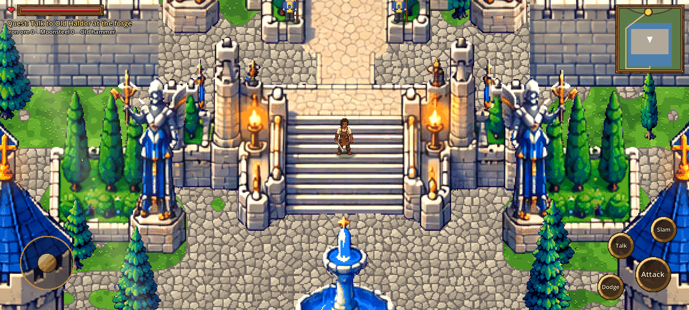

# Stage 17: The Royal Castle built from the castle6 sheets

**Commit:** see docs/README.md

## What changed
- **Built from the new sheets, not the old map.** The castle is now built entirely from the ten castle6 sheets (walls, towers, gatehouses, palace, buildings, gardens, trees, cliffs, waterfalls), placed where the approved castle map has them. The old blurry map is no longer drawn at all.
- **No seams.** Everything is composited into **one seamless image**, 4572 × 4572 px. Pieces are drawn with a depth buffer: each pixel knows the line it stands on, and something further south always covers something further north. Joins between pieces hide behind whatever stands in front of them.
- **Sheet pixels, never resized.** Pieces use their sheet's own pixels at whole-number scales: 2× for architecture, 1× for trees. Resizing the AI art (stage 16, and Claude Code's first try) blurred it further.
- **Walls along lines.** A wall run is laid down as copies of one wall section with their feet on the line, in a single strip, so it has no visible joins.
- **Ground** (paving, lawns, water, rock) is generated in colours taken from the sheets. Because it's generated rather than tiled, it has no tile edges.
- **Walking uses footprints.** Only the ground an object actually stands on blocks Kael. He can walk behind a tower's roof or a tree's crown, and the occluder draws them over him.
- **Lights** (torches and braziers) are found in the picture automatically.

## Files
| File | Role |
|------|------|
| `tools/import_castle7.py` | Cuts the castle6 sheets at native size → `art/castle7/<group>/` |
| `tools/castle7_layout.py` | Every piece (crop, scale, flat/standing parts) and where it stands on the 1728 map |
| `tools/castle7_ground.py` | Ground, cliffs and tree positions from the map |
| `tools/castle7_build.py` | Composites everything → `art/castle7/out/` (6×6 colour and depth chunks, `collision.json`, `lights.json`, `preview.png`) |
| `scripts/castle_outer.gd` | Loads the chunks: ground layer, occluder above Kael, collision, lights, guards |
| `scripts/geo.gd` | `CASTLE_S = 4572/864`, `CASTLE_O = (-2286, 5616)`; the south road ends further south |

Rebuild after editing the layout: `cd tools && python3 castle7_build.py`.

## Tests
- **Walk test** (`castlewalk7.gd`) passes every leg:
  - up the causeway, through both gates, over the bridge
  - round the fountain, up the grand stairs to the palace door
  - along the plaza both ways
- **Blocking:** Kael is stopped by the lake.
- **Mission 1** completes with `CASTLE_ONLY := false`.

## Known limits
- **Pixel size:** the castle6 art draws one sheet pixel as 2 world pixels, so it is still coarser than Kael (1 px). This was chosen over redrawing it as true pixel art.
- **Simplified areas:** some inner terrace walls and the north-east bridges are simpler than on the map, and the market houses sit partly on a wall walk.
