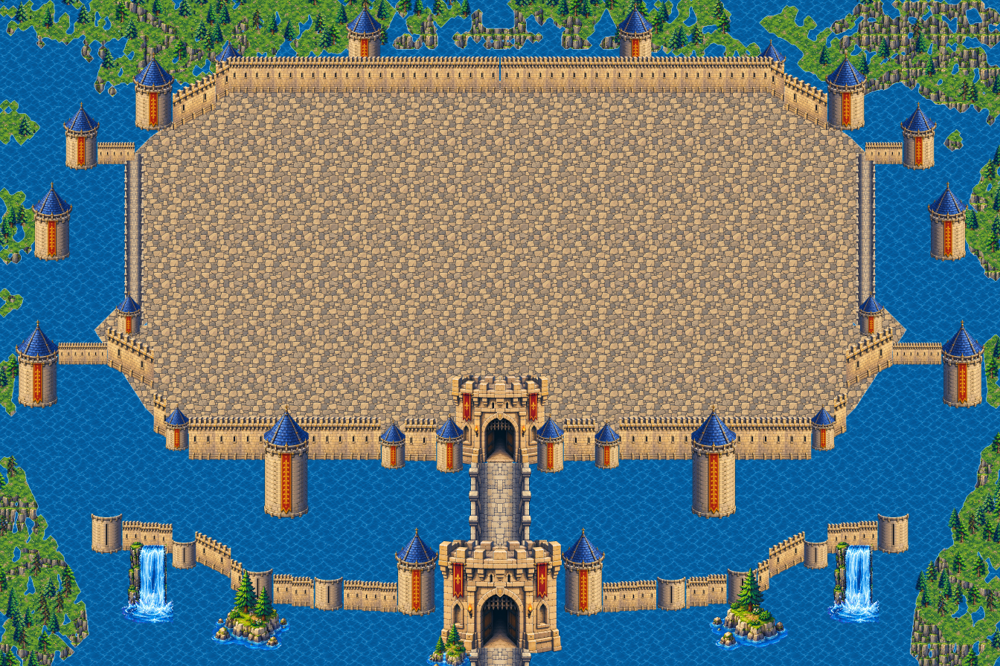
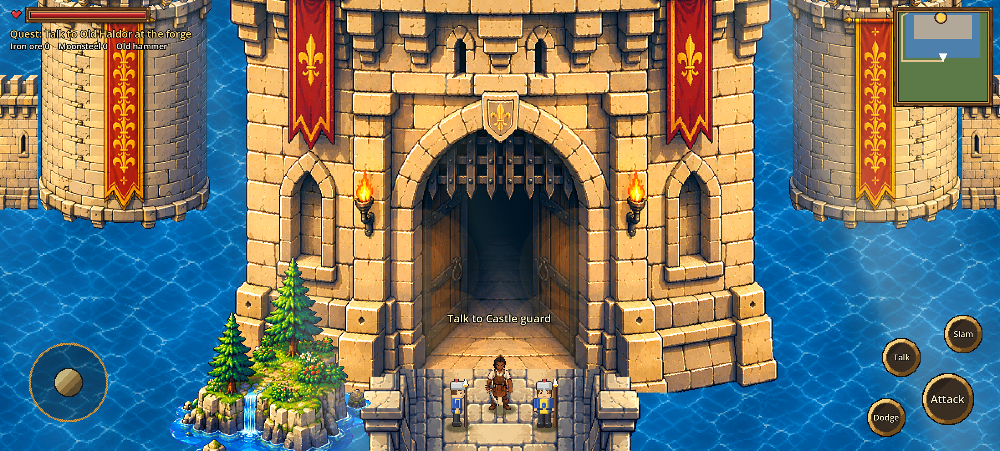

# Stage 18: Royal Castle rebuilt from scratch, outer layer

**Commit:** see docs/README.md

## Why
- **Invisible walls:** the stage-17 castle worked out where you could walk from the picture itself, which left invisible walls in places.
- **New reference:** the castle also had a new reference picture (`source_art/castle8/castle_ref.png`) and a full set of coworker assets (S-001 to S-079).
- **Clean slate:** all old castle data (`art/castle4` to `art/castle7`) was deleted and the castle was started again.

## What was built (outer layer)
- **Water and land:** the lake and moat, land with trees, and rocky cliffs around the castle.
- **Outer barbican wall:**
  - roofless turrets and two flag towers;
  - two waterfalls under the wall;
  - rocky islets in the moat.
- **Approach:** the causeway with torches and two gatehouses, outer and inner.
- **Main wall:** towers standing in the water, including the two big water towers.
- **Perimeter:** the west and east towers, bridges, wall-walks and the back wall.
- **Inside:** plain paving for now. Interior buildings come in later stages.

## How
- **Coordinates:** `tools/castle8_build.py` places everything in reference pixels; 1 ref px = 3.5 world px.
- **Assets:**
  - Each one is cut from its magenta sheet and shrunk by area averaging, with hard alpha.
  - **Tilt fix:** the generator tilted the "straight" wall (its foot dropped 0.40 per px) and the diagonal one (0.58 instead of 0.5). Each column is remapped so the front face becomes an exact rectangle at the right slope. Verticals stay vertical; nothing is rotated.
  - **Gatehouse fix:** the generator drew the gatehouse turned (its right side wall shows) although the prompt asked for front-facing. The straight left half is mirrored about the arch's centre, found by testing which line makes the arch, shield and portcullis most symmetric, so the gate is exactly front-facing.
- **Towers:** a body segment (with or without a banner), stacked taller with plain masonry where needed, plus the conical roof.
- **Walking is explicit:**
  - Kael can walk only on the causeway strip (through both gate arches) and the inner enclosure polygon.
  - Collision boxes are made only from those shapes, never from the picture.
  - So there are no invisible walls inside them, and the moat and walls always block.
- **Game side:** `scripts/castle_outer.gd` loads the chunks using `meta.json`. In `scripts/geo.gd`, `Geo.rp(x, y)` now takes reference px.

## Tests
- **Walk test** (`castlewalk8.gd`):
  - up the causeway, through both gates, and over the bridge;
  - round all four sides and both diagonals of the courtyard;
  - **blocked as expected:** the moat and the front wall stop Kael.
- **Mission 1** completes in the full game.

## Next
- **Inner layer:** the palace, cathedral, domed hall, manor, market, training yard, gardens, fountain and terraces, each with its own walkable area.

## Fixes after the first review
- **Square around Kael:** the occluder (a copy of the castle drawn over Kael inside a box around him) is gone. Everything upright is now cut into strips by the line it stands on (12 px bands, `upright.json` plus `up_N.png` atlases). Each strip is a y-sorted sprite next to Kael and the NPCs, so everyone goes behind or in front of walls by their feet, with no box.
- **Gaps between wall sections:** the generator drew an end face on each wall section. Only the front face is kept, so sections join seamlessly.
- **Towers:** taller towers repeat their own middle rows instead of stacking a second segment, so there is no seam.
- **Causeway:**
  - pieces use only the rows where both parapets exist, and are made symmetric;
  - it no longer runs behind the gatehouses.
- **Gate passages:** the dark opening (one connected area) lies on the ground, so Kael is visible walking through the arch.
- **Symmetry:** each wall run is built for the west and mirrored as a whole for the east.
- **Guards:** they stand on the causeway in front of each gate, not on the gate's art.
- **Courtyard edge:** the courtyard paving runs under the wall-walks, so no water shows between the courtyard and the walls.
