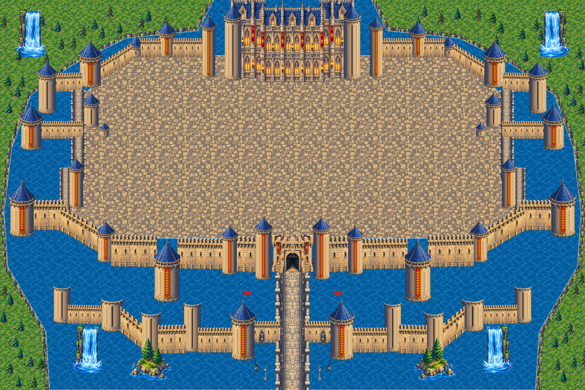
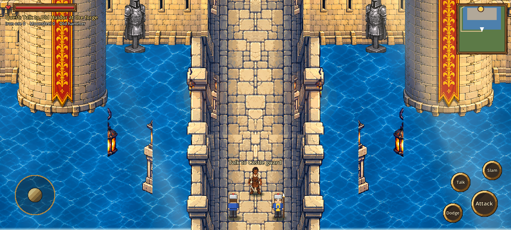

# Stage 19: Outer castle built from a traced blueprint

**Commit:** see docs/README.md

## Why
The stage-18 castle was placed piece by piece, roughly, and looked glued together. So the reference was first traced into an exact blueprint, `source_art/castle8/blueprint.json` (drawn over the reference in `blueprint_overlay.png`). The user reviewed it and circled the missing parts, which were then added.

## What the blueprint holds
Everything is given in reference px for the west half, and mirrored for the east.
- **Towers (22):** centre, base line, width and top for each.
- **Walls (13):** their foot lines and tops.
- **Bridges and wall-walks:** spans and widths.
- **Palace:** the main block and its wings.
- **Inner gate.**
- **Causeway with its props:** torch posts, knight statues and lantern pillars.
- **Land:** waterfalls and islets.
- **Walkable areas:** the courtyard and the causeway.

## Construction rules (`tools/castle9_build.py`)
- **Walls run tower to tower:** each wall's ends tuck behind towers, so no wall ends in open air.
- **Walls are one strip:** each wall is a single strip at its exact length, tiled from whole battlement periods so the merlons never restart. Diagonal walls are sheared column by column to the blueprint slope.
- **Towers match the blueprint:** each is built to its width and height by repeating its own masonry, then the roof is added. The two flag towers carry pennants.
- **Exact mirroring:** the east half is the west half mirrored as finished pieces.
- **Ground from explicit shapes:**
  - water inside the castle outline;
  - grass and a cliff band outside it;
  - paving on the walkable areas and wall-walks.
  - Nothing is guessed from colours.
- **Walking:** only on the blueprint's walkable polygons; collision is made from them alone.
- **Land:** only a band of land around the lake; the town and the land north of the castle are gone. This land is a placeholder to improve later.

## Tests
- **Walk test:** passes.
  - up the causeway, through the inner gate;
  - round the courtyard, both diagonals, and back out;
  - **blocked as expected:** the moat and the front wall stop Kael.
- **Mission 1** completes.

## Known limits
- **Courtyard:** plain paving; the inner buildings, gardens and terraces are the next stage.
- **Palace:** the facade is a single flat front for now.
